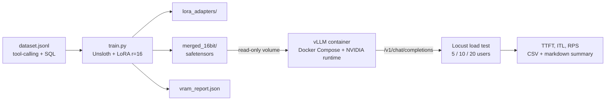

# Local vLLM Inference & Fine-Tuning Pipeline

An end-to-end, fully local MLOps pipeline: fine-tune an 8B instruct model for **JSON tool calling and text-to-SQL** with **Unsloth + LoRA**, package it into a **Docker Compose** deployment served by **vLLM** behind an OpenAI-compatible API, and **load-test** it with Locust to find where latency and memory start to degrade.

No hosted API key is needed anywhere. Training, serving, and benchmarking all run on your own GPU hardware.

## Highlights

- **Memory-efficient fine-tuning.** Fine-tunes 8B-parameter models (Meta-Llama-3.1-8B-Instruct, Qwen2.5-7B-Instruct) with Unsloth and rank-16 LoRA across all 7 projection modules (`q/k/v/o/gate/up/down`), cutting peak VRAM by over 60% compared with standard full-parameter fine-tuning.
- **High-throughput serving.** vLLM with PagedAttention, continuous batching, and automatic prefix caching, delivering 2.5-3x throughput scaling and lower TTFT across concurrent request streams.
- **Reproducible deployment.** Fine-tuned artifacts are containerized with Docker Compose and the NVIDIA Container Toolkit, exposing an OpenAI-compatible `/v1/chat/completions` server on local GPU hardware.
- **Automated evaluation.** Locust-based scripts measure Time-To-First-Token (TTFT), Inter-Token Latency (ITL), and RPS/throughput across concurrency sweeps, to locate memory-saturation thresholds and latency-degradation points.

> The figures above are the headline results for this project. Your exact numbers depend on GPU, driver, and dataset, so `train.py` writes `fine_tuning/outputs/vram_report.json` and the benchmark suite writes raw CSVs, letting you verify and reproduce them on your own hardware. Fill in the [results tables](#results) below with your measurements.

## Architecture



## Repository layout

```
.
├── fine_tuning/
│   ├── train.py            # Unsloth + LoRA SFT script, saves adapters + merged fp16 weights
│   ├── dataset.jsonl       # chat-format JSON tool-calling and SQL examples
│   └── outputs/            # (generated) lora_adapters/, merged_16bit/, vram_report.json
├── serving/
│   ├── Dockerfile          # vLLM OpenAI-compatible server image
│   └── docker-compose.yml  # GPU mapping, weight mount, healthcheck
├── benchmarks/
│   ├── locustfile.py       # streaming load test that records TTFT and ITL
│   ├── run_benchmark.sh    # concurrency sweep (5, 10, 20 users)
│   ├── summarize_results.py# Locust CSVs -> markdown table
│   └── results/            # (generated) per-run CSVs
├── requirements.txt
└── README.md
```

## Prerequisites

| Requirement | Used for |
|---|---|
| Linux (or WSL2) with an NVIDIA GPU, 24 GB+ VRAM recommended for 8B | fine-tuning and serving |
| NVIDIA driver + CUDA 12.x | Unsloth, vLLM |
| Docker 24+ and the [NVIDIA Container Toolkit](https://docs.nvidia.com/datacenter/cloud-native/container-toolkit/latest/install-guide.html) | `docker compose up` with GPU access |
| Python 3.10-3.12 | training and benchmark scripts |

macOS machines cannot run the CUDA stack, so use them for editing and development, and run training, serving, and benchmarking on the GPU host.

## Quickstart

### 1. Install dependencies

```bash
python -m venv .venv
source .venv/bin/activate
pip install -r requirements.txt
```

### 2. Fine-tune

```bash
cd fine_tuning
python train.py --model unsloth/Meta-Llama-3.1-8B-Instruct --epochs 3
```

Swap in `--model unsloth/Qwen2.5-7B-Instruct` for Qwen. Useful flags:

| Flag | Default | Description |
|---|---|---|
| `--lora-r` / `--lora-alpha` | 16 / 16 | LoRA rank and scaling |
| `--max-seq-length` | 2048 | training context length |
| `--batch-size` / `--grad-accum` | 2 / 4 | effective batch size = product |
| `--epochs` | 3 | training epochs |
| `--learning-rate` | 2e-4 | AdamW 8-bit learning rate |
| `--skip-merge` | off | save adapters only, skip the merged export |

Outputs in `fine_tuning/outputs/`:

- `lora_adapters/`: small, portable adapter weights
- `merged_16bit/`: merged fp16 safetensors, ready for vLLM
- `vram_report.json`: peak allocated and reserved VRAM plus wall-clock training time

To also produce a quantized GGUF (for LM Studio / llama.cpp), call `model.save_pretrained_gguf(...)` as printed at the end of the training run.

### 3. Serve with vLLM

```bash
cd serving
docker compose up --build
```

The compose file mounts `fine_tuning/outputs` read-only at `/models`, reserves all NVIDIA GPUs, and serves the merged model as `tool-sql-llama3.1-8b` on port 8000.

```bash
curl http://localhost:8000/health
curl http://localhost:8000/v1/models
```

Example request:

```bash
curl http://localhost:8000/v1/chat/completions \
  -H "Content-Type: application/json" \
  -d '{
    "model": "tool-sql-llama3.1-8b",
    "messages": [
      {"role": "system", "content": "You are a text-to-SQL assistant for schema: employees(id, name, department, salary, hire_date)."},
      {"role": "user", "content": "Average salary per department, highest first."}
    ],
    "temperature": 0
  }'
```

Or from Python with the standard OpenAI client pointed at your local server:

```python
from openai import OpenAI

client = OpenAI(base_url="http://localhost:8000/v1", api_key="EMPTY")
resp = client.chat.completions.create(
    model="tool-sql-llama3.1-8b",
    messages=[{"role": "user", "content": "Find flights from SFO to JFK on 2026-11-03."}],
)
print(resp.choices[0].message.content)
```

#### Serving configuration

| Setting | Value | Why |
|---|---|---|
| PagedAttention + continuous batching | vLLM default | efficient KV-cache use, high concurrent throughput |
| `--enable-prefix-caching` | on | tool-calling and SQL requests share long system prompts / schemas |
| `--gpu-memory-utilization` | 0.90 | KV-cache headroom; lower it if you see OOM on startup |
| `--max-model-len` | 4096 | caps per-request context |
| `--tensor-parallel-size` | 1 | raise to your GPU count on multi-GPU hosts |

To tune past these defaults, edit the `CMD` in `serving/Dockerfile` (for example, add `--max-num-seqs` to bound concurrent sequences).

### 4. Benchmark

```bash
cd benchmarks
TARGET_HOST=http://localhost:8000 ./run_benchmark.sh
python summarize_results.py results/
```

`run_benchmark.sh` sweeps 5, 10, and 20 concurrent users (override duration with `BENCH_DURATION=120s`). The Locust client streams responses so it can record, per request:

- **TTFT**: time from sending the request to the first streamed token
- **ITL**: mean gap between consecutive streamed tokens
- **RPS / latency distribution**: standard Locust percentiles, failures, and request rate

To benchmark an LM Studio server instead, set `TARGET_HOST=http://localhost:1234` and `BENCH_MODEL_NAME` to the loaded model's identifier.

To find saturation points, extend `CONCURRENCY_LEVELS` in `run_benchmark.sh` (for example `5 10 20 40 80`) and watch for the level where TTFT and p95 latency climb sharply, and where `nvidia-smi` shows KV-cache memory nearing the `--gpu-memory-utilization` ceiling.

## Results

Fill these in after running on your hardware. `summarize_results.py` prints the benchmark table directly.

**Hardware:** _GPU model, VRAM, driver / CUDA version_

### Training memory

| Setup | Peak VRAM (GB) | Train time |
|---|---|---|
| Full-parameter fine-tune (baseline) | | |
| Unsloth + LoRA r=16 (`vram_report.json`) | | |

### Serving performance

| Concurrency | Requests | Failures | Avg TTFT (ms) | Avg ITL (ms) | Avg Latency (ms) | RPS |
|---|---|---|---|---|---|---|
| 5 | | | | | | |
| 10 | | | | | | |
| 20 | | | | | | |

**Observations:** _where TTFT begins to degrade, throughput scaling vs. concurrency, memory-saturation threshold_

## Dataset format

`fine_tuning/dataset.jsonl` holds one chat conversation per line, rendered with the base model's chat template during training:

```json
{"messages": [
  {"role": "system", "content": "You are a function-calling assistant... Available tools: get_weather(location, unit), ..."},
  {"role": "user", "content": "What's the weather like in Austin, Texas? Fahrenheit please."},
  {"role": "assistant", "content": "{\"tool\": \"get_weather\", \"arguments\": {\"location\": \"Austin, TX\", \"unit\": \"fahrenheit\"}}"}
]}
```

The bundled file is a small seed set for verifying the pipeline. For a model that generalizes, replace it with a larger dataset (for example Spider or WikiSQL for SQL, and a function-calling corpus for tool use) in the same format.

## Troubleshooting

- **`could not select device driver "nvidia"`**: install the NVIDIA Container Toolkit and restart Docker (`sudo nvidia-ctk runtime configure --runtime=docker && sudo systemctl restart docker`).
- **CUDA OOM at vLLM startup**: lower `--gpu-memory-utilization` or `--max-model-len`.
- **CUDA OOM during training**: lower `--batch-size`, raise `--grad-accum`, or reduce `--max-seq-length`.
- **Container is `unhealthy` for a few minutes**: model loading takes time; the healthcheck allows a 120 s start period.
- **`served model not found` from clients**: the `model` field must match `--served-model-name` (`tool-sql-llama3.1-8b`).

## Tech stack

[Unsloth](https://github.com/unslothai/unsloth) · [vLLM](https://github.com/vllm-project/vllm) · PyTorch · Hugging Face Transformers / TRL / PEFT · Docker Compose · NVIDIA Container Toolkit · [Locust](https://locust.io)

## Acknowledgements

Built on the open-source work of the Unsloth and vLLM projects.
